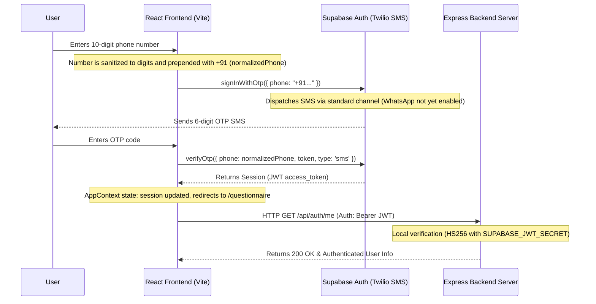

# Frontend Context: Slay Health (website/client)

This document provides an in-depth reference to the frontend codebase, architecture, state management, and external service integrations for the **Slay Health** web application.

---

## 🏗️ System Architecture & Data Flow

Slay Health utilizes a modern decoupled microservices-based layout where the React frontend client acts as the central orchestrator connecting authentication, user state, localized risk computations, Express data storage, and the clinical FastAPI evaluation engine.

### 1. Authentication & JWT Handshake
All user authentications are managed via Supabase Client OTP using standard SMS dispatch. The returned session token (JWT) is used to authorize operations on the Express Backend. Email auth is strictly optional or deprecated in favor of Phone Identity.



### 2. Clinical Scoring & Microservices Pipeline
The frontend allows upload of PDF reports and custom manual clinical parameter overrides. It posts this payload to the local Express Backend, which proxies the multi-part data directly to the FastAPI clinical evaluation engine, saving the JSON result struct to the Postgres Database before echoing it back to the client.

```mermaid
flowchart TD
    subgraph Client [React Frontend (Vite)]
        UI[SampleReportPage.tsx]
        PDF[Upload Female/Male PDF Reports]
        MO[Collapsible Manual Overrides Sidebar]
        Chart[MFR Conception Progression Chart]
    end

    subgraph Express [Express Backend - Port 4000]
        Proxy[POST /api/matches/:id/analyze]
        DB[(PostgreSQL Prisma DB)]
    end

    subgraph ScoringMicroservice [FastAPI Backend - Port 8000]
        API[FastAPI Router - POST /analyze_and_interpret]
        OCR[PDF Text OCR Extraction]
        LLM[LLM Structured Information Parsing]
        Rules[Clinical Rules Engine]
    end

    UI -->|Multipart Form: PDFs & Overrides| Proxy
    Proxy -->|Axios Form Data| API
    API --> OCR
    OCR --> LLM
    LLM --> Rules
    Rules -->|Returns JSON Score & Interpretation| Proxy
    Proxy -->|Stores analysisResult| DB
    Proxy -->|Returns updated Match object| UI
    UI --> Chart
```

---

## 🛠️ Technology Stack
* **Core:** React (v18.3.1) with TypeScript, built using Vite (v5.4.21).
* **Styling:** TailwindCSS with custom typography configurations (e.g., handwriting style font `.font-script` for titles/highlights).
* **Animations:** Framer Motion (for smooth micro-animations, slide-ins, and active-tab transitions).
* **UI Components:** Built using standard Radix UI primitives (Accordion, Alert Dialog, Hover Card, Tabs, Select, Toast, etc.).
* **State Management:** Custom React Context ([AppContext.tsx](file:///Users/pranavsingh/Desktop/untitled%20folder%202/slay_health/website/client/src/context/AppContext.tsx)) combined with TanStack React Query for query fetching, caching, and state synchronization.
* **Icons:** Lucide React icons.

---

## 📁 Key File Structure & Architecture

### 1. Global Setup & Routing
* **[main.tsx](file:///Users/pranavsingh/Desktop/untitled%20folder%202/slay_health/website/client/src/main.tsx)**: Standard React client-side entry point.
* **[App.tsx](file:///Users/pranavsingh/Desktop/untitled%20folder%202/slay_health/website/client/src/App.tsx)**: Main application wrapper defining routing paths, wraps pages under a shared [Layout](file:///Users/pranavsingh/Desktop/untitled%20folder%202/slay_health/website/client/src/components/Layout.tsx) component, and exposes global context providers (`QueryClientProvider`, `TooltipProvider`, `Toaster`, `AppProvider`).
* **[index.css](file:///Users/pranavsingh/Desktop/untitled%20folder%202/slay_health/website/client/src/index.css)**: Holds root colors, HSL color tokens, Tailwind directives, custom fonts (`@import` for modern Google fonts like outfit/cursive scripts), and specific animation definitions.

### 2. State & Context Management
* **[AppContext.tsx](file:///Users/pranavsingh/Desktop/untitled%20folder%202/slay_health/website/client/src/context/AppContext.tsx)**:
  * **Language Support:** Manages global localization language configuration (`en`, `hi`, `bn`, `te`, `ta`, `gu`, `kn`, `mr`, `pa`, `ur`).
  * **Viewing Modes:** Tracks who is viewing the compatibility report (`candidate` | `parent` | `counselor` | `couple`).
  * **User Profiles:** Stores the self/candidate profiles and comparative prospect details (demographics, meeting source, lifestyle traits).
  * **Matches State:** Manages the active premarital compatibility scoring matches (`Match` interface) and dynamically computes compatibility scores (ranges from `70-99`).
  * **Authentication Session:** Automatically resolves `supabase.auth.getSession()` on load and synchronizes credentials via a state hook bound to `supabase.auth.onAuthStateChange`.

---

## 🗂️ Detailed Directory Breakdowns

### 1. Page Component Mapping (`src/pages/`)
The application implements **18 functional router endpoints**:
* **[HomePage.tsx](file:///Users/pranavsingh/Desktop/untitled%20folder%202/slay_health/website/client/src/pages/HomePage.tsx):** High-impact landing page featuring real medical risks (infertility statistics, STD transmissions, chronic illness family history, and genetic carriers). Displays testimonials, pricing tiers, and trust signals.
* **[LoginPage.tsx](file:///Users/pranavsingh/Desktop/untitled%20folder%202/slay_health/website/client/src/pages/LoginPage.tsx):** Handles phone SMS verification using Supabase standard OTP client methods. Pre-validates numbers (removes non-digits, requires exactly 10 digits) and prepends the Country Code (`+91`). Includes a 30-second countdown cooldown throttler for resends and automatically redirects users to `/questionnaire` upon active session acquisition.
* **[QuestionnairePage.tsx](file:///Users/pranavsingh/Desktop/untitled%20folder%202/slay_health/website/client/src/pages/QuestionnairePage.tsx):** Candidate profile input steps (demographics, history, lifestyle).
* **[AddProspectPage.tsx](file:///Users/pranavsingh/Desktop/untitled%20folder%202/slay_health/website/client/src/pages/AddProspectPage.tsx):** Comparative prospect demographics input questionnaire.
* **[ReportsPage.tsx](file:///Users/pranavsingh/Desktop/untitled%20folder%202/slay_health/website/client/src/pages/ReportsPage.tsx):** Renders dynamic compatibility reports based on five main sections: pathology, genetics, lifestyle, mental health, and radiology.
* **[SampleReportPage.tsx](file:///Users/pranavsingh/Desktop/untitled%20folder%202/slay_health/website/client/src/pages/SampleReportPage.tsx):** Renders active PDF upload triggers and structured compatibility results. Integrates:
  * **Manual Overrides Sidebar**: Collapsible inputs to override values for the Female partner (e.g., Bilateral Tubal Block, cycle length, flow duration), Male partner (e.g., Azoospermia, Semen values, Varicocele), and Couple parameters.
  * **MFR Conception Chart**: Calculations of conception probability month-by-month: $P(\text{Month } N) = 1 - (1 - \text{MFR})^N$, styled by dynamic risk levels.
* **[ScoringMatrixPage.tsx](file:///Users/pranavsingh/Desktop/untitled%20folder%202/slay_health/website/client/src/pages/ScoringMatrixPage.tsx):** Transparent breakdown of clinical compatibility calculation weights, multipliers, penalty logic, and safety block overrides.
* **[ClinicalSafetyPage.tsx](file:///Users/pranavsingh/Desktop/untitled%20folder%202/slay_health/website/client/src/pages/ClinicalSafetyPage.tsx):** Outlines details on clinical testing protocols, NABL certifications, doctor validation, and security guidelines.
* **[TrustPrivacyPage.tsx](file:///Users/pranavsingh/Desktop/untitled%20folder%202/slay_health/website/client/src/pages/TrustPrivacyPage.tsx):** Explicit details on HIPAA compliance, data masking, database encryption keys, and privacy controls.
* **[WhyItMattersPage.tsx](file:///Users/pranavsingh/Desktop/untitled%20folder%202/slay_health/website/client/src/pages/WhyItMattersPage.tsx):** Science-backed data detailing genetic carrier screenings and why premarital screenings are vital.
* **[HowItWorksPage.tsx](file:///Users/pranavsingh/Desktop/untitled%20folder%202/slay_health/website/client/src/pages/HowItWorksPage.tsx):** Visual timeline guide explaining home sample collections, lab processes, and doctor-signed report deliveries.
* **[DashboardPage.tsx](file:///Users/pranavsingh/Desktop/untitled%20folder%202/slay_health/website/client/src/pages/DashboardPage.tsx):** Logged-in profile dashboard listing match requests, pathology status, and scores.
* **[FontShowcasePage.tsx](file:///Users/pranavsingh/Desktop/untitled%20folder%202/slay_health/website/client/src/pages/FontShowcasePage.tsx):** Development layout page to review design elements (buttons, grids, animations, highlights).
* **[ContactPage.tsx](file:///Users/pranavsingh/Desktop/untitled%20folder%202/slay_health/website/client/src/pages/ContactPage.tsx):** Simple query submissions page.
* **[CulturalPage.tsx](file:///Users/pranavsingh/Desktop/untitled%20folder%202/slay_health/website/client/src/pages/CulturalPage.tsx):** Explore alignment on family values, child rearing, and financial goals.
* **[GrowthPage.tsx](file:///Users/pranavsingh/Desktop/untitled%20folder%202/slay_health/website/client/src/pages/GrowthPage.tsx):** Relational guidance links.
* **[PrivacyPolicy.tsx](file:///Users/pranavsingh/Desktop/untitled%20folder%202/slay_health/website/client/src/pages/PrivacyPolicy.tsx):** Legal context.
* **[NotFound.tsx](file:///Users/pranavsingh/Desktop/untitled%20folder%202/slay_health/website/client/src/pages/NotFound.tsx):** 404 handler.

### 2. Shared Helper Components (`src/components/`)
* **[LifestyleForm.tsx](file:///Users/pranavsingh/Desktop/untitled%20folder%202/slay_health/website/client/src/components/LifestyleForm.tsx):** Input collection form capturing standard lifestyle habits (activity, occupational constraints, sleep patterns, height/weight, menstrual frequency).
* **[CitySearch.tsx](file:///Users/pranavsingh/Desktop/untitled%20folder%202/slay_health/website/client/src/components/CitySearch.tsx):** Autocomplete filter matching local regions to support location-based risk indicators.
* **[OccupationSearch.tsx](file:///Users/pranavsingh/Desktop/untitled%20folder%202/slay_health/website/client/src/components/OccupationSearch.tsx):** Dynamic input selector grouping workspaces to assess potential chemical or high-stress hazards.
* **[StoryVisuals.tsx](file:///Users/pranavsingh/Desktop/untitled%20folder%202/slay_health/website/client/src/components/StoryVisuals.tsx):** Infographics showcasing screening benefit comparisons and standard medical costs.
* **[ScoreGauge.tsx](file:///Users/pranavsingh/Desktop/untitled%20folder%202/slay_health/website/client/src/components/ScoreGauge.tsx):** SVG progress gauge displaying the total biological and composite match values.

### 3. Static Configuration Datasets (`src/data/`)
* **`communityRisks.ts`**: Regional disease risks for localized dashboard cards.
* **`personas.ts`**: Demographic personas mapped to onboarding templates.
* **`pricingPlans.ts`**: Core pricing options starting from ₹799.
* **`sampleReport.ts`**: Fallback compatibility result object.
* **`testimonials.ts`**: Real-world user stories on gaining premarital clarity.

---

## 🎨 Branding, Styles & Typography Context

### 1. Typography & Fonts
* **Sans-Serif Font:** `'Inter'`, `'SF Pro Display'`, system-ui, sans-serif (used for UI elements, labels, body copy, and secondary headings).
* **Handwriting Script Font (`.font-script`):** `'Caveat'`, cursive (used for emotive headings, highlights, callouts, and emphasis lines).

### 2. Core Color Palette
* **Primary Brand Green:** `#17CB96` (RGB variable `160 77% 45%` for Tailwind custom primary classes).
* **Secondary Brand Pink:** `#DE457D` (RGB variable `340 70% 55%` for secondary text details).
* **Coral Action Text:** `#f97171` (`.text-coral-500`).
* **Light Pink Background:** `#FCEEF0` (`.bg-brand-pink-light`).
* **Main CTA Red:** `#D4544C` (used for active buttons, submit inputs, and focus highlights).

### 3. Decorative Style Helpers & Underlines
* **Wavy Underlines:**
  * Blue wavy underline: `.curly-underline` (uses `#0EA5E9` with wavy style, offset `6px`).
  * Orange wavy underline: `.curly-scribble-underline` (uses `#FFA500` with wavy style, offset `6px`).
* **Organic Highlight Blobs:** Use rotated inline backgrounds to create hand-drawn effects:
  * Purple: `.organic-highlight-purple` (`rgba(139, 92, 246, 0.25)`)
  * Pink: `.organic-highlight-pink` (`rgba(222, 69, 125, 0.25)`)
  * Blue: `.organic-highlight-blue` (`rgba(14, 165, 233, 0.25)`)
  * Yellow/Mint: `.organic-highlight-yellow` (`rgba(59, 208, 156, 0.3)`)
  * Green: `.organic-highlight-green` (`rgba(16, 185, 129, 0.25)`)
  * Lavender: `.organic-highlight-lavender` (`rgba(167, 139, 250, 0.3)`)

### 4. Interactive Call-to-Actions & Gradients
* **Core Brand Gradient:** `.gradient-brand` (a linear gradient from `#17CB96` to `#DE457D`).
* **Interactive Buttons (`.btn-gradient`):**
  * Applies the primary gradient.
  * Transitions smoothly on hover: shifts background slightly, scales up (`scale-102`), and applies a glowing drop-shadow (`rgba(23, 203, 150, 0.3)`).

---

## 🔒 Security & Client Environment Rules
1. **Public Key Limits**: The frontend only references public client environment keys:
   * `VITE_SUPABASE_URL`
   * `VITE_SUPABASE_ANON_KEY`
2. **Service Role Safeguards**: High-privilege keys (e.g. Supabase Service Role Key) must **never** be added to the frontend `.env` to prevent client-side credential extraction.
3. **Local Token Handshake**: On requests to the backend server, the client attaches the Supabase `access_token` inside the headers. The backend decrypts and verifies the claims signature locally using `SUPABASE_JWT_SECRET`.
