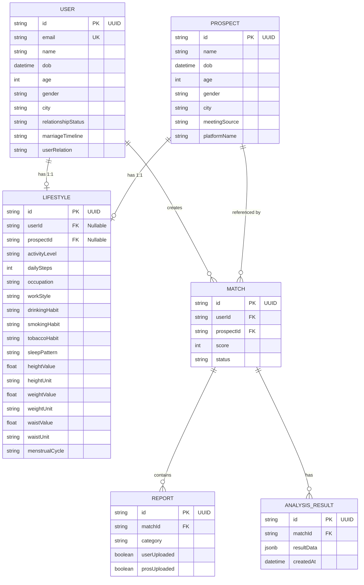

# Backend Context: Slay Health (website/server)

This document provides a detailed reference to the backend Express server architecture, local token signature verification middleware, relational Prisma database schemas, API routes, and operational guides for the **Slay Health** resource server.

---

## 🏗️ Relational Database Entity-Relationship Model

The PostgreSQL database is managed via Prisma ORM. The schema models candidates, matrimonial prospects, their individual biological/lifestyle profiles, match associations, and diagnostics upload checklists.



### Model Definitions
1. **`User`**: Core account details representing the logged-in candidate. Phone is used as a unique identifier. Cascades lifestyle deletes.
2. **`Lifestyle`**: 1-to-1 extension of traits for either a `User` or a `Prospect` (utilizing unique nullable FK constraints `userId` and `prospectId`).
3. **`Prospect`**: Demographic context on the proposed matchmaking partner.
4. **`Match`**: Tracks a compatibility pairing. Includes completion status (`pending` | `analyzing` | `completed`) and matching scores.
5. **`Report`**: Diagnostic checkpoints partitioned by category (`pathology` | `radiology` | `genetic` | `mentalHealth` | `lifestyle`). Employs a compound unique key `@@unique([matchId, category])` to prevent double-entries.
6. **`AnalysisResult`**: JSON storage containing the direct serialized response from the FastAPI Interpretability Engine for caching and auditing.

---

## 🔒 Security & Local JWT Signature Validation

The Express server functions as an OAuth 2.0 Resource Server. Rather than forwarding client authentication sessions over the network on every transaction, the API conducts local JWT signature checks using HS256 decryption.

### 1. Token Middleware Pipeline
* **File Location**: [authMiddleware.ts](file:///Users/pranavsingh/Desktop/untitled%20folder%202/slay_health/website/server/src/authMiddleware.ts)
* **Execution Flow**:
  1. Inspects the incoming HTTP request headers for an `Authorization` field.
  2. Ensures the token conforms to `Bearer <JWT_STRING>`.
  3. Uses the configured `SUPABASE_JWT_SECRET` to locally verify the HMAC-SHA256 signature.
  4. Binds the decrypted claims metadata onto the request object as `req.user` (including `sub`, `email`, `role`, and `phone` values).
  5. Short-circuits invalid signatures, structural faults, or expired tokens with an HTTP `401 Unauthorized` response.

### 2. JWT Configuration Keys (`.env`)
* **`PORT`**: Port number for Express listener (default: `4000`).
* **`DATABASE_URL`**: Transaction-mode Supavisor pooler string (port `6543`) with `pgbouncer=true` query arguments.
* **`DIRECT_URL`**: Session-mode Supavisor connection string (port `5432`) for running migration tasks.
* **`SUPABASE_URL`**: Public Supabase project url endpoints.
* **`SUPABASE_JWT_SECRET`**: Cryptographic secret key shared with the Supabase dashboard project, used to decode access tokens locally.

---

## 📁 File Structure & Core API Endpoints

### 1. File Tree
```
website/server/
├── prisma/
│   └── schema.prisma        # Database relational models
├── src/
│   ├── authMiddleware.ts    # JWT token validation rules
│   └── index.ts             # API routes and server listener
├── test-oauth.js            # Mock token validation testing script
└── package.json             # Engine and dependencies
```

### 2. Exposed API Endpoints
All endpoints under `/api/*` are guarded by the `authMiddleware` check and require a signed Bearer header.

* **`GET /health`** [Public]: Returns health check status of the server.
* **`GET /api/auth/me`** [Protected]: Returns parsed credentials (user ID, phone number, token metadata) of the caller.
* **`GET /api/users`** [Protected]: Returns users together with their linked `Lifestyle` data models.
* **`POST /api/users`** [Protected]: Accepts demographic and nested lifestyle parameters to provision a new user profile.
* **`GET /api/matches`** [Protected]: Fetches all matches, including candidate demographics, prospect details, and reports.
* **`GET /api/matches/:id`** [Protected]: Fetches a specific match by ID alongside its associated `AnalysisResult` data for frontend hydration.
* **`POST /api/matches/:id/analyze`** [Protected]: Proxies FormData containing uploaded PDF reports and manual text inputs directly to the FastAPI (`http://localhost:8000/analyze_and_interpret`) engine. Updates the DB match status and persists the JSON.

---

## 🛠️ Operations & Execution Guides

### 1. Start Server for Development
```bash
# Install dependencies
npm install

# Run hot-reloading dev server
npm run dev
```

### 2. Verify Compilation
```bash
npm run build
```

### 3. Database Migration Procedures
```bash
# Push prisma changes directly to Supabase
npx prisma db push

# Generate Prisma Client
npx prisma generate

# Launch visual admin panel
npx prisma studio
```
